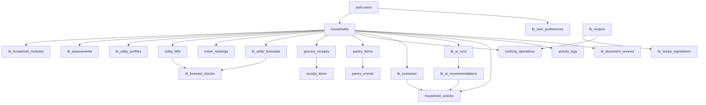

# LiveBetter — Database owner handoff

**Date:** 13 November 2026  
**Stack:** Supabase (PostgreSQL + Auth), Python FastAPI, Gemini, React Native/Expo  
**Status:** Proposed integration migration; **not applied to your live Supabase project or runtime-tested there**. Keep an export/backup and compare the audit with the current schema before applying.

## 1. Immediate finding from the uploaded project code

| Component | Observed current implementation | Required integration change |
|---|---|---|
| Food (Shruti) | Supabase-backed FastAPI. The uploaded `01_livebetter_schema.sql` defines the base schema and atomic `confirm_grocery_receipt`, recipes, AI-recipe drafts and cooking. `02_lb_confirm_cooking_v2.sql` replaces cooking RPC. | **Preserve** tables/RPC signatures; do not rebuild or rename. |
| Water (Sanjana) | `water/store.py` uses `water_state.json`. Routes read/write this local file. Uses a static HMAC token login. | Replace storage with household-scoped Supabase reads/writes; adopt Supabase Auth. |
| Electricity (Alexandra) | `electricity/store.py` uses `electricity_state.json`. Routes read/write this file. Same static HMAC authentication. | Replace storage with Supabase; adopt Supabase Auth. |
| Big Brain (notebook/guide) | Reads `households`, `utility_bills`, `meter_readings`, `grocery_receipts`, `receipt_items`, `pantry_items`, `household_actions`, `activity_logs`. Current notebook initializes a privileged client and selects the first household for testing. | Enforce the logged-in user's household; persist AI run snapshots and ranked recommendation evidence. |

**Do not treat the ZIP archives as evidence that the deployed Supabase DB already has matching tables.** Run the read-only audit first. The Food schema uses `CREATE TABLE IF NOT EXISTS`, which does **not** repair different pre-existing columns or constraints.

## 2. Existing database — do NOT duplicate

Base tables from the uploaded Food SQL:

| Table | Purpose | Primary relationship |
|---|---|---|
| `auth.users` (Supabase-managed) | Account credentials and sessions | Never create a second password store |
| `households` | Household owner, size, currency, preferences, budget goals | `owner_id` -> `auth.users.id` |
| `utility_bills` | Verified water and electricity history | `household_id` -> `households.id`, `kind` = water/electricity |
| `meter_readings` | Dated actual meter readings | Household, utility kind |
| `extracted_documents` | Legacy OCR text, globally hashed | Privileged only; **not scoped to household** in provided SQL |
| `grocery_receipts` | Confirmed purchase header | Household, source identifier unique per household |
| `receipt_items` | Each purchased line | `receipt_id` -> `grocery_receipts.id` |
| `pantry_items` | Current ingredient stock | Household, name, unit; nonnegative quantity |
| `pantry_events` | Stock addition/deduction journal | Household, pantry item, signed delta, operation |
| `cooking_operations` | Idempotency key for cooking once | Household + recipe ID |
| `household_actions` | Selected/completed savings actions | Household |
| `activity_logs` | Audit trail for household events | Household |
| `lb_recipes` | Shared verified or private AI-generated recipes | Optional household owner |
| `lb_recipe_ingredients` | Ingredient requirements and units | `recipe_id` -> `lb_recipes.id` |

Atomic RPCs already in uploaded SQL:

- `confirm_grocery_receipt(...)`: one receipt and one stock addition, on the first accepted source identifier only.
- `lb_save_ai_recipe(...)`: save a **private, pending** generated recipe.
- `lb_confirm_cooking(...)`: `02_lb_confirm_cooking_v2.sql` implements idempotent cooking, unit conversions and logs skipped unavailable ingredients. Confirm whether skipping untracked ingredients satisfies the final UX; user walkthrough expects explicit review of shortages.

## 3. Proposed new tables (migration 03)

| New table | Required? | Stores |
|---|---|---|
| `lb_user_preferences` | P0 | Auth user ID, English/French/Kreol locale and privacy consent timestamp |
| `lb_household_modules` | P0 | Which specialist modules are enabled/ready |
| `lb_assessments` | P0 | Versioned answers to 4 general and 5 optional questions per module |
| `lb_utility_profiles` | P0 | Water/electricity tariff, budget, profile JSON, optional habits |
| `lb_utility_forecasts` | P0 | Historical/meter-backed projected units, MUR, period, evidence, confidence, tariff source |
| `lb_ai_runs` | P0 | One Big Brain computation's domain snapshots, status, decision context and full dashboard JSON |
| `lb_ai_recommendations` | P0 | Source/module/action ID, calculated savings, confidence, evidence, assumptions, rank, Gemini explanation |
| `lb_document_reviews` | P1 | **Unconfirmed** OCR proposals per household; never counted as a bill/purchase until confirmation |
| `lb_scenarios` | P1 | Water/electricity/food/cross-module what-if, baseline vs new projection; does not edit actual history |
| `lb_appliances` | P1 | Optional editable electrical loads used for quantified scenarios |
| `lb_forecast_checks` | P1 | Prior prediction versus a later verified bill, for evidence-based reliability |

Migration 03 also adds nullable provenance fields to `utility_bills`, optional amount scope to grocery receipts, and links from existing `household_actions` to recommendations/scenarios. It permits a **NULL** billed amount when the consumption units are known but the price on the source is not.

## 4. Relationships / mental model



`lb_recipes` can also belong to a household when privately AI-generated; verified global recipes have `household_id = NULL`.

## 5. SQL installation order

1. Open **Supabase Dashboard → SQL Editor**. Run `00_schema_audit_readonly.sql`, saving the output. Verify the existing names/types. Export a database backup before changing existing data.
2. **Already have the Food tables and RPCs?** Do **not** re-run the Food baseline merely because it is included as a reference. Confirm the base table/function signatures against the audit. **Fresh Supabase project?** Run `01_existing_food_schema_reference.sql` then `02_existing_cooking_v2_reference.sql` (team-provided code, unmodified).
3. Run `03_livebetter_integration_extension.sql` in the SQL Editor, then `04_atomic_big_brain_rpc.sql`. Both execute inside transactions; review any errors rather than editing around them blindly. The migration is additive except it loosens `utility_bills.amount` to nullable; it does not wipe any rows or replace Food functions.
4. Re-run the audit. Check `pg_policies`, source columns and composite foreign keys. Test using **two Supabase Auth accounts**: A cannot see/edit B's household.
5. Authenticate on the mobile client with Supabase Auth; send its **access JWT** to FastAPI. FastAPI verifies the user and obtains its allowed `household_id` before every query. Use the existing Food `core.auth.get_household_context` as the starting pattern.
6. Never place `SUPABASE_SECRET_KEY`/service-role key or `GEMINI_API_KEY` in Expo or shared commits. Never use the demo HMAC token as a Supabase JWT. Disable `LIVEBETTER_NO_AUTH` outside localhost.

**Important:** The original notebook's privileged `create_client(... SUPABASE_SECRET_KEY)` bypasses RLS; do not copy it into a user-facing route. `collect_household_data` must accept and verify the calling user's household ID, instead of selecting the first available household.

## 6. Precise module-to-database mapping

### General onboarding (four required questions)

- `households.members`: exact integer from G1.
- `lb_assessments` with `module='general'`, version 1: G1 residents, G2 home type, G3 typical occupancy, G4 primary improvement goal.
- `households.preferences` can keep the current general snapshot for compatibility; keep `lb_assessments` for history. Do not invent answers for optional fields.
- `lb_user_preferences.preferred_language`: `en`, `fr`, `mfe`.
- `lb_household_modules` has one row per enabled specialist.

### Water (Sanjana)

| Current Water module field | Supabase destination |
|---|---|
| `state.household` | `households` plus `lb_assessments(module='general')` |
| `state.profile.sewer`, `.region`, `.has_air_conditioning`, `.monthly_budget_rs` | `lb_utility_profiles(kind='water')`: `profile` JSON and `monthly_budget_mur` |
| `state.assessments[]`, versions | `lb_assessments(module='water')`; answers preserve W1-W5 |
| `state.bills[]`: `start`, `end`, `m3`, `amount_rs` | `utility_bills(kind='water')`: `period_start`, `period_end`, `units`, `amount`, `tariff_code` |
| `state.readings[]`: `date`, `index_m3` | `meter_readings(kind='water')`: `captured_at`, `reading` |
| `state.forecasts[]` | `lb_utility_forecasts(kind='water',unit='m3')` |
| `state.checks[]` | `lb_forecast_checks` (only with real bill IDs) |
| `state.scenario_runs[]` | `lb_scenarios(module='water')` |
| `state.actions[]` | `household_actions` and/or `lb_ai_recommendations` when returned to Big Brain |
| `state.activity[]` | `activity_logs` |

### Electricity (Alexandra)

| Current Electricity module field | Supabase destination |
|---|---|
| `state.profile.ceb_tariff`, `.tv_licence`, `.monthly_budget_rs` | `lb_utility_profiles(kind='electricity')`: tariff, `profile`, monthly budget |
| `state.assessment` or `state.profile` answers | `lb_assessments(module='electricity')` |
| `state.bills[]`: `start`, `end`, `kwh`, `amount_rs`, `tariff_class` | `utility_bills(kind='electricity')`: dates, `units`, amount, tariff code |
| `state.readings[]`: `date`, `index_kwh` | `meter_readings(kind='electricity')`: date and cumulative meter reading |
| Profile's editable appliance data | `lb_appliances`, with explicit measured-versus-assumed flag |
| `forecast()` output | `lb_utility_forecasts(kind='electricity',unit='kWh')` |
| `state.actions[]` | `household_actions`, module recommendations |
| `state.activity[]` | `activity_logs` |

**Migration caution:** Current local demo bill IDs such as `s1` and `ceb1` are **not UUIDs**. Do not insert them into PostgreSQL UUID primary keys. Assign new UUIDs and keep any original demo source identifier in `utility_bills.source_metadata`. Do not persist placeholder/synthetic readings as real observations.

### Food (Shruti)

- `POST /receipts/parse`: OCR proposal only; **no spending or stock change**.
- `POST /receipts/confirm`: existing `confirm_grocery_receipt` RPC writes `grocery_receipts`, `receipt_items`, `pantry_items`, `pantry_events`, `activity_logs` atomically. Reusing the same `source_identifier` must not double-charge/double-add.
- `GET /pantry`: reads `pantry_items` by household.
- `GET /recipes` and `POST /recipes/recommend`: access `lb_recipes` and `lb_recipe_ingredients` (verified real catalogue / private drafts).
- `POST /recipes/{id}/cook`: existing `lb_confirm_cooking` with a stable UUID operation ID writes stock reductions; never create a second expense.
- `grocery_receipts.total`: **the teammate's current receipt API sends food-only total**, whereas the original notebook may have stored whole-receipt totals. Existing records must not be silently labeled as all-food totals. The new `amount_scope` starts `unknown`; set it accurately only after reviewing provenance.
- Existing Food API has no pantry manual edit endpoint in its uploaded router; that must be implemented separately for the promised 'mark unavailable' journey.

### Big Brain (central intelligence)

1. Load user-owned `households`, confirmed `utility_bills`, `meter_readings`, `grocery_receipts`, `receipt_items`, `pantry_items`, `household_actions`, `activity_logs`, latest assessments and forecast records.
2. Request `/water/summary`, `/electricity/summary`, and `/food/summary` only if enabled. **The Food ZIP currently does not provide `/food/summary`; build an adapter.**
3. Each module returns domain recommendations (shape below); persist a single `lb_ai_runs` row with `module_status`, `module_summaries`, `decision_context`, and `dashboard`.
4. Persist each normalized recommendation in `lb_ai_recommendations`, tied to `run_id` and `household_id`, including `source`, `module`, `action_id`, `confidence`, `evidence`, `assumptions`, `estimated_savings_mur`, optional ranked `priority_score`, and Gemini `explanation`.
5. When the user saves/completes an action, create or update `household_actions`, link `recommendation_id` or `scenario_id` and write `activity_logs`. Do not claim that a hypothetical scenario is achieved savings.

**Critical contract mismatch:** Water/Electricity currently return module summaries with recommendation fields like `id`, `saving.cost_rs`, `evidence`; the Big Brain guide expects `action_id`, `estimated_savings_mur`, `confidence`, `assumptions`. Convert them in backend code. Also unify `insufficient_data` / `no_data` status naming before the front end integrates.

## 7. Canonical Big Brain recommendation JSON

```json
{
  "module": "electricity",
  "action_id": "reduce_ac_usage",
  "title": "Reduce air conditioner usage",
  "estimated_savings_mur": null,
  "confidence": "low",
  "evidence": {"source_bill_ids": [], "calculation_method": "awaiting measured bill"},
  "assumptions": {"period": "monthly", "currency": "MUR"}
}
```

This example deliberately uses `null` for cost without a module-produced calculation. A specific cost must be calculated by the module from a valid baseline, assumptions and appropriate tariff.

Example to insert one Big Brain run and its recommendations using a **user-scoped Supabase client**:

```python
from uuid import uuid4

run_id = str(uuid4())
result = db.table('lb_ai_runs').insert({
    'id': run_id,
    'household_id': household_id,  # verified as belonging to the JWT user
    'status': dashboard['status'] if dashboard['status'] in ('success', 'partial') else 'failed',
    'model_name': gemini_model_name,
    'module_status': dashboard['module_status'],
    'module_summaries': domain_summaries,
    'decision_context': decision_context,
    'dashboard': dashboard,
}).execute()

rows = []
for action in combined_actions:
    rows.append({
        'run_id': run_id,
        'household_id': household_id,
        'source': action['source'],  # 'domain' or 'big_brain'
        'module': action['module'],
        'action_id': action['action_id'],
        'title': action['title'],
        'estimated_savings_mur': action.get('estimated_savings_mur'),
        'confidence': action.get('confidence'),
        'evidence': action.get('evidence') or {},
        'assumptions': action.get('assumptions') or {},
        'priority_score': action.get('priority_score'),
        'explanation': action.get('explanation'),
    })
if rows:
    db.table('lb_ai_recommendations').insert(rows).execute()
```

**Atomicity note:** The two REST `.insert()` calls above are **not** one database transaction. Prefer the supplied **`04_atomic_big_brain_rpc.sql`** and call its single authenticated `lb_save_ai_run` RPC instead. It saves the run, every action and the audit event in one transaction. Keep the same `p_run_id` for network retries; a repeated run ID is idempotent. Example:

```python
run_id = str(uuid4())  # make once; reuse on retry
result = db.rpc('lb_save_ai_run', {
    'p_run_id': run_id,
    'p_household_id': household_id,
    'p_status': 'success',
    'p_model_name': gemini_model_name,
    'p_module_status': dashboard['module_status'],
    'p_module_summaries': domain_summaries,
    'p_decision_context': decision_context,
    'p_dashboard': dashboard,
    'p_actions': rows,  # normalized Big Brain actions as JSON array
}).execute()
```

`rows` in the example above contains the action objects; the RPC extracts its expected fields. The frontend must not claim that a failed run was saved.

## 8. Shared APIs required for integration

| Feature | Proposed route/owner | Reads/writes |
|---|---|---|
| Auth | Supabase Auth from Expo | `auth.users`, no custom password table |
| Onboard household | `POST /households/onboarding` DB/backend owner | `households`, `lb_assessments` |
| Water profile, assessment | `GET/PUT /water/profile`, `GET/PUT /water/assessment` Water+DB | `lb_utility_profiles`, `lb_assessments` |
| Electricity profile, assessment | `GET/PUT /electricity/profile`, `GET/PUT /electricity/assessment` Elec+DB | `lb_utility_profiles`, `lb_assessments` |
| Confirm bill | `POST /water/bills` or `POST /electricity/bills` | `utility_bills`, `activity_logs` |
| Meter reading | `POST /water/readings` or `/electricity/readings` | `meter_readings`, `activity_logs` |
| Forecast and summary | `GET /water/summary`, `/electricity/summary` | Bills, readings, assessments; optionally forecast snapshots |
| Food receipt confirmation | Existing `POST /receipts/confirm` | Existing atomic SQL RPC |
| Pantry correction | Proposed `PATCH /pantry/{id}` | `pantry_items`, `pantry_events`, `activity_logs` **in one transaction** |
| Cooking | Existing `POST /recipes/{id}/cook` | Existing idempotent SQL RPC |
| AI integrated dashboard | Proposed `GET /household/insights` | `lb_ai_runs`, `lb_ai_recommendations`; generates new run if requested |
| What-if | `POST /household/scenarios` | `lb_scenarios`, **never** update actual bills |

### Common household authentication pattern

The Food module already uses `get_household_context`. Adopt it in the Water and Electricity routers. The mobile app signs in through Supabase, sends `Authorization: Bearer <supabase_access_jwt>` on all requests, and the backend checks `ctx.household_id`. No API should trust an unverified `household_id` supplied by the client.

## 9. Must-pass tests before the live demo

- **Auth isolation:** User A cannot read or insert a record for User B's household, including recommendation rows and OCR reviews.
- **General onboarding:** Four required answers saved and still available after relogin; optional modules can be skipped.
- **Water/Elec:** Confirmed bill produces row in `utility_bills`, real meter reading in `meter_readings`, forecast snapshot in `lb_utility_forecasts`. Unknown amount remains NULL.
- **No fabricated forecasts:** No confirmed bill/valid readings -> no personalized consumption forecast or invented MUR total.
- **Food receipts:** Same `source_identifier` confirmed twice -> one purchase and one pantry increment.
- **Cooking:** Same operation UUID retried -> only one pantry deduction; cooking never creates expense.
- **Manual pantry edit:** Mark unavailable, log why, check recipe ranking updates.
- **Big Brain:** Retrieve all three summaries, convert their output to one common action format, store one `lb_ai_runs` entry and associated `lb_ai_recommendations` with evidence. No duplicate charges. Periods must align before totaling forecasts and food purchases.
- **Actions:** Selecting/completing a recommended action saves one event; forecasted savings do not become 'realized savings' until validated.
- **Security:** Turn off demo bypass; no Supabase secret/service key or Gemini API key in public GitHub/Expo.

## 10. Suggested order for the database owner tonight

1. Audit existing Supabase schema and verify the Food functions.
2. Apply extension and test RLS with two accounts.
3. Give the team **one demo household UUID**, Supabase project URL and **publishable** key; keep privileged secrets off chat and repository.
4. Tell Water and Electricity owners to replace their JSON `load/save` layer and HMAC login; provide the mapping above.
5. Tell Big Brain owner to add the source-format adapter and persist runs/recommendations.
6. Ensure the Food owner implements manual pantry edit and the `food/summary` adapter, if in scope.
7. Do the end-to-end test from the phone: signup → assessment → bills → forecasts → receipt → pantry → recipe → cooking → AI → persistence after restart.

### Known uncertainties requiring a live check

- No direct access to the live Supabase project; its actual current schema could differ from the provided SQL.
- SQL migration not executed against the user's Supabase; take a backup and run audit first.
- Water/Electricity module integration is not completed by database DDL: the Python stores still need wiring.
- Sources and accuracy of CEB/CWA tariff tables, data licensing and demonstration dates must be reviewed by module owners; database storage alone does not verify them.
- The project's baseline SQL has v2 cooking semantics that skip ingredients absent from the pantry while logging them. Decide whether to block cooking instead, based on the final UX, before the demo.
